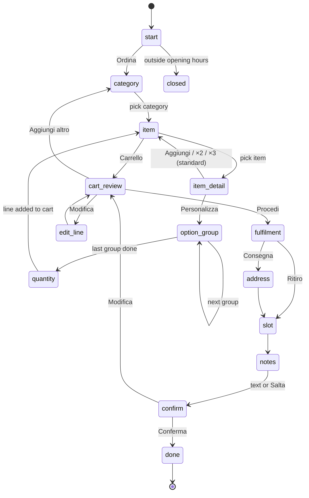

# Design v1 — data model & guided flow

**Status:** draft, 2026-10-15. Built from a *typical* Italian pizzeria menu,
not a real one. Every assumption is tagged **[A#]** and must be checked
against the first real menus (see CONTEXT.md §4, step 1).

---

## 1. Reference menu (synthetic)

What a small pizzeria menu usually looks like. Used to shape the model and,
later, as a test fixture. Prices are IVA-inclusive.

| Category | Item | Price | Notes |
|---|---|---|---|
| Pizze classiche | Marinara | 5.00 | pomodoro, aglio, origano |
| | Margherita | 6.00 | pomodoro, mozzarella, basilico |
| | Diavola | 7.50 | + salame piccante |
| | Capricciosa | 8.50 | + prosciutto cotto, funghi, carciofi, olive |
| | Quattro formaggi | 8.50 | |
| Pizze speciali | Bufala | 9.50 | mozzarella di bufala DOP |
| | Tartufo | 12.00 | |
| Calzoni | Calzone classico | 8.00 | |
| Fritti | Supplì | 2.00 | |
| | Patatine | 3.50 | |
| Bevande | Acqua 50cl | 1.50 | |
| | Coca-Cola 33cl | 2.50 | |
| | Birra Moretti 33cl | 3.50 | age-restricted |
| Dolci | Tiramisù | 5.00 | |

Options seen on most pizza menus:

| Option group | Applies to | Choice | Price delta |
|---|---|---|---|
| Dimensione | pizze, calzoni | Normale / Maxi (+4.00) / Baby (−1.00) | per option |
| Impasto | pizze, calzoni | Classico / Integrale (+1.00) / Senza glutine (+2.50) | per option |
| Aggiunte | pizze, calzoni | Mozzarella di bufala +2.00, Prosciutto crudo +2.00, Funghi +1.00, Olive +0.50, … | per option |

Assumptions:

- **[A1]** 20–60 items, 4–8 categories, no category above ~15 items.
- **[A2]** Size and dough change price by a fixed delta, same for every pizza.
- **[A3]** Extras cost the same regardless of size.
- **[A4]** Removals ("senza cipolla") are free and go in kitchen notes, not as options.
- **[A5]** No half-and-half ("metà e metà") and no "pizza al metro" in v1.
- **[A6]** Payment on pickup / delivery (cash or card at the door). No online payment in v1.
- **[A7]** Customer-facing language is Italian only in v1.

---

## 2. Data model

All tables carry `restaurant_id` (decision 3). Money is `NUMERIC(9,2)` /
`Decimal`. IDs are UUIDs unless noted.

### Menu (operator-managed)

```
restaurants        id, name, slug, timezone, currency='EUR', vat_rate,
                   pickup_enabled, delivery_enabled, delivery_fee_eur,
                   min_order_eur, created_at

categories         id, restaurant_id, name, position, active

menu_items         id, restaurant_id, category_id, name, description,
                   base_price_eur, allergens (int[]), available, position,
                   age_restricted

option_groups      id, restaurant_id, name, position,
                   min_select, max_select          -- Dimensione: 1/1, Aggiunte: 0/N
options            id, option_group_id, name, price_delta_eur,
                   allergens (int[]), is_default, available, position

item_option_groups menu_item_id, option_group_id   -- which groups an item offers
```

- `allergens` are the 14 EU allergens (Reg. 1169/2011) as numbers 1–14. They
  are shown from the DB only, never typed by anyone but the operator.
  An extra can add allergens (e.g. bufala → milk). **[A8]** allergens are
  entered by the operator at import; the bot never infers them.
- `item_option_groups` instead of attaching groups per category, so a drink
  never shows "Impasto". Import can fill it per category as a shortcut.
- One price rule: **unit price = base_price + Σ price_delta of chosen options.**

### Ordering hours & slots

```
opening_hours      restaurant_id, weekday, opens_at, closes_at   -- several rows per day OK
slot_settings      restaurant_id, slot_minutes (15), max_orders_per_slot,
                   min_lead_minutes (20)
```

- **[A9]** Orders are for "as soon as possible" or a slot later the same day;
  no next-day orders.

### Conversation & cart (customer-side)

```
conversations      id, restaurant_id, channel ('telegram'|'whatsapp'),
                   customer_ref (chat id / phone), state, state_data (jsonb),
                   cart (jsonb), updated_at, expires_at
```

- One row per `(restaurant_id, channel, customer_ref)`. `state` is the
  current step; `state_data` holds the in-progress line (item, chosen options).
- Cart lines store **IDs only** (`menu_item_id`, `option_ids`, `quantity`).
  Prices are recomputed from the menu every time the cart is shown and at
  confirm — if an item became unavailable or a price changed, the customer
  sees it before confirming.
- Cart lives in PostgreSQL with `expires_at` (2 h idle), not Redis (open
  question in CONTEXT.md, recommended).

### Orders (immutable snapshot at confirm)

```
orders             id, restaurant_id, public_code ('A-0427'), channel,
                   customer_ref, customer_name, fulfilment ('pickup'|'delivery'),
                   address, postcode, slot_at, kitchen_notes,
                   items_total_eur, delivery_fee_eur, total_eur,
                   vat_rate, vat_eur, net_eur, status, created_at

order_lines        id, order_id, menu_item_id, name_snapshot,
                   unit_price_eur, quantity, subtotal_eur

order_line_options order_line_id, option_id, name_snapshot, price_delta_eur
```

- Snapshots (`name_snapshot`, prices) make old orders survive menu edits.
- `kitchen_notes`: optional, ≤ 300 chars, control chars stripped, forwarded
  verbatim, never parsed (decision 1). PII → covered by retention policy.
- `public_code` is short and per-restaurant, for the kitchen and the customer.

### Impact on existing code

`pizzabot/order/schema.py` will need: `menu_item_id` + option lines on
`CartItem`, `fulfilment`, `address`, `slot_at`, `kitchen_notes`,
`delivery_fee_eur`. Not changed yet — after this draft is approved.

---

## 3. Guided flow

Goal: few taps. The standard pizza is one tap from its screen, and after an
add the customer is back on the same category list, so each further pizza is
two taps (item → Aggiungi). Three different standard pizzas + checkout ≈ 14
taps (was ≈ 30 when every pizza went through size → dough → extras →
quantity → "add more?").

Each state renders one **screen**: text + options. Options are buttons on
Telegram and reply buttons / list messages on WhatsApp. Every screen except
`start` has **⬅ Indietro** (back) and **✖ Annulla** (cancel).



| State | Screen | Options | Rules |
|---|---|---|---|
| `start` | Greeting + restaurant name | Ordina | Shows `closed` with hours if outside opening hours |
| `category` | "Cosa desideri?" | active categories with ≥1 available item | |
| `item` | category name (after an add: "✓ Aggiunto: …") | available items, name + price; 🛒 Carrello (count — total) | paginate if > page size |
| `item_detail` | name, description, price, **allergens**, "Standard: Normale, Classico" | ➕ Aggiungi / ×2 / ×3 / ⚙️ Personalizza | Aggiungi adds the **standard** version: first available option of each required group, no extras. Personalizza only if the item has option groups |
| `option_group` | group name, e.g. "Dimensione" | options with price delta, standard pre-marked ✓ | single-select: pick → next group. Multi-select (Aggiunte): pick adds, screen repeats with ✓ marks, **Avanti** to continue; enforces min/max |
| `quantity` | line summary + unit price | 1–9 | only after Personalizza |
| `cart_review` | lines + total (recomputed) | Procedi / Modifica / Aggiungi altro | flags unavailable items; blocks Procedi below `min_order_eur` |
| `edit_line` | pick a line | remove / change quantity | |
| `fulfilment` | | Ritiro / Consegna | only enabled modes shown |
| `address` | "Indirizzo di consegna?" | free text (address only) | **[A10]** postcode checked against a delivery-zone list |
| `slot` | | Prima possibile + next free slots | full slots hidden |
| `notes` | "Note per la cucina?" | free text or **Salta** | ≤ 300 chars, verbatim |
| `confirm` | full summary: lines, fee, total, IVA, slot, address, notes | Conferma / Modifica | prices recomputed one last time |
| `done` | order code + "ti avvisiamo quando è pronto" | | order persisted, kitchen notified |

Free text in any state other than `address` and `notes` → "Usa i pulsanti
qui sotto 👇" and the current screen is shown again.

### Channel limits

The state machine emits a channel-neutral screen; adapters paginate.

- **Telegram:** inline keyboards, effectively no practical limit for a menu.
  `callback_data` is small (64 bytes) → buttons carry short IDs, not names.
- **WhatsApp:** reply buttons and list messages have small caps (roughly 3
  buttons, ~10 list rows). **Verify current limits in Meta docs before
  building the adapter.** Long categories get "Altri ▶" pagination.

Page size is an adapter setting, so the state machine stays the same.

---

## 4. Open questions

1. Real menus: do [A1]–[A5] hold? Especially sizes, extras priced per size,
   half-and-half.
2. Delivery zones: postcode list, radius, or fee per zone?
3. Customer name: ask for it, or use the channel profile name?
4. Age-restricted drinks (beer) on delivery: show a notice only, or block?
5. Payment: is pay-on-pickup/delivery enough for the pilot? **[A6]**
6. IVA rate and fiscal scope (accountant) — see CONTEXT.md §3.
